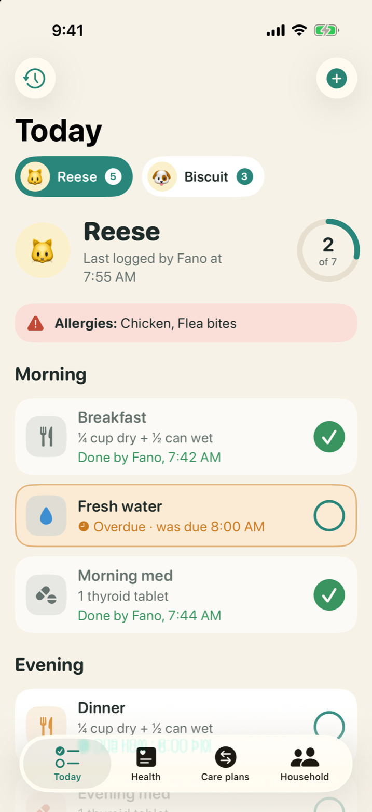
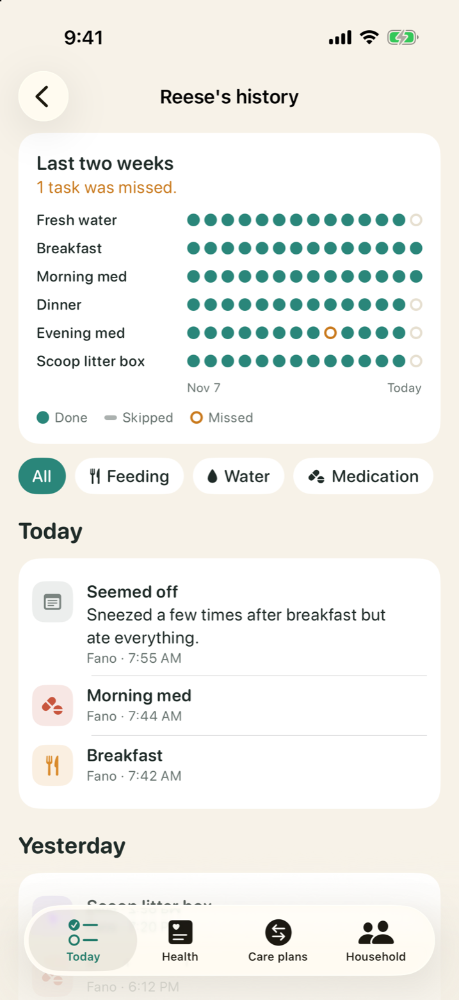
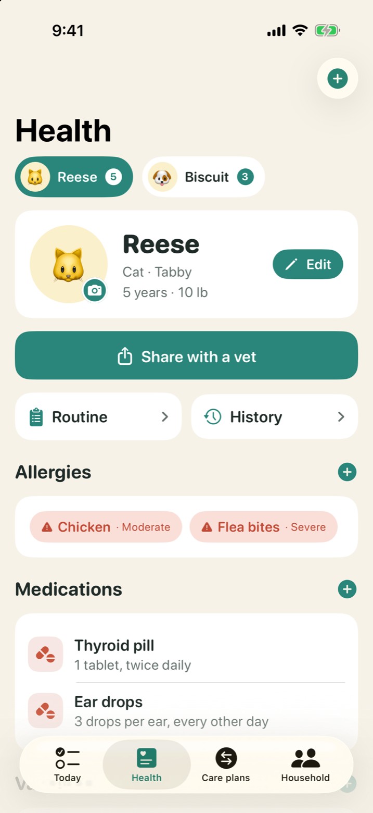
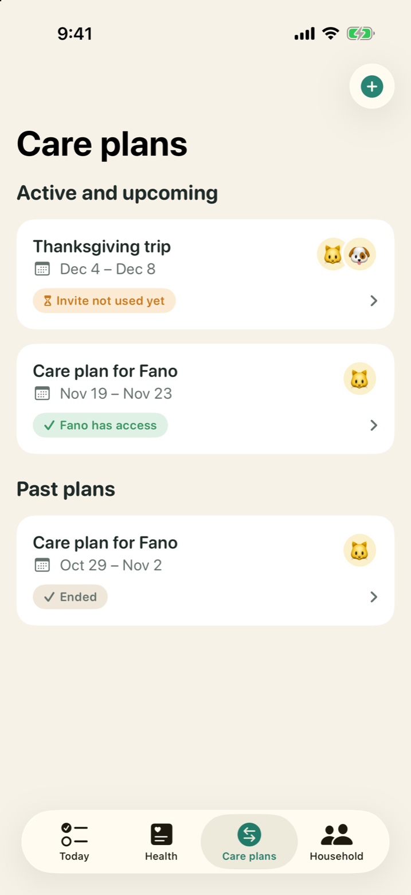
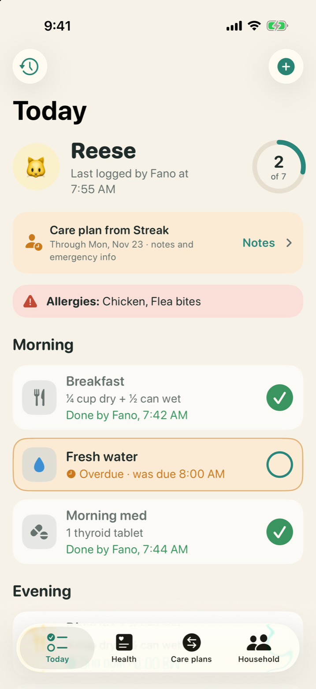

# Tandem

A shared care record for pets. iOS app built with SwiftUI and Supabase for 95-422 Managing Digital Transformation.

Most pets are cared for by more than one person, and nobody has the full picture: the dog gets fed twice, or a dose gets missed. Tandem lets an owner set up a pet's routine once. Everyone who helps works from the same record and checks off what they do, so the next person knows what's already done. Care can be handed to a sitter for a few days with a scoped care plan, and to a vet with a one-page summary.

<p>
  
  
  
  
  
</p>

## Features

| Area | What it does |
|---|---|
| **Today** | A per-pet checklist for the day. One tap logs a task with who did it and when. Two people can't log the same task twice. Allergies are always visible. Notes, skip and undo are supported. |
| **Routine** | Feeding, water, walks, medication, cleaning, grooming and custom tasks. Tasks repeat daily, on chosen weekdays, every N days, or once. Occasional tasks and vaccines appear under "Coming up". |
| **History** | Who did what and when, filterable by kind of care and by person, with a two-week grid that makes a missed task obvious. |
| **Health** | Allergies, medications, vaccines, weight trend, vet and emergency contacts, and photos of documents. |
| **Vet summary** | The owner picks what to include and shares a PDF. The vet needs no account. |
| **Care plans** | Hand care to a sitter for a date range. The plan is generated from the existing routine. The sitter joins with a 6-character code, link or QR code, sees only what the plan includes, and loses access automatically when it ends. |
| **Household** | People who share care every day, invites, sitters with temporary access, and account settings. |
| **Notifications** | Local reminders when a timed task is due, and push notifications when another caregiver logs something. |

Any species is supported, with several pets per household. One person can own pets in one household and be a sitter for another.

## Getting started

Requirements: a Mac with Xcode 26.1 or later. The app targets iOS 17 and later.

1. Clone the repo and open `Tandem.xcodeproj`.
2. Choose an iPhone simulator and press Run. Xcode downloads the one dependency (`supabase-swift`) on the first build.
3. Sign in with a demo account, or create your own.

The app talks to a hosted Supabase project. Its URL and publishable key are in `Tandem/Services/Backend.swift`; the publishable key is designed to ship inside an app, and what each person can read or change is enforced in the database.

### Demo data

`supabase/seed.sql` builds a demo household: an owner, two roommates, two pets with two weeks of history, and a sitter whose care plan is active today. The account emails and their shared password are in the comment at the top of that file.

Running the file in the Supabase SQL editor rebuilds the demo household from scratch and re-dates everything to today. It only touches the demo accounts.

### Running on a phone

Select your device and press Run. To sign the app under a different Apple developer account, change the Team (and, if needed, the bundle identifier) under the target's Signing & Capabilities tab. Push notifications and Sign in with Apple need a paid developer account; everything else works without one.

### Launch arguments for testing

Debug builds accept launch arguments that sign in and open a tab directly, which is useful for screenshots and repeatable tests:

```
-autoLoginEmail <demo email> -autoLoginPassword <demo password> -startTab 0
```

Tabs are numbered 0 (Today) to 3 (Household).

## Project structure

```
Tandem/
  App/            App entry point, root navigation, tab bar
  Models/         Data types, plus Schedule.swift (turns routines and logs into today's tasks)
  Store/          AppStore: all app state and every call to the backend
  Services/       Supabase client, local reminders, push registration
  DesignSystem/   Colors, buttons, cards, shared components, animations
  Features/       One folder per screen area: Auth, Onboarding, Today, Routines,
                  History, Health, Plans, Household, Shared
Config/           Info.plist and entitlements
supabase/
  migrations/     Database schema, access rules and server functions, in order
  functions/      Edge functions (notify: sends push notifications)
  seed.sql        Demo data
docs/screenshots/ Images used in this README
```

The Xcode project uses a synchronized folder, so any Swift file added under `Tandem/` is picked up without editing the project file.

## How it works

**State and sync.** `AppStore` holds everything the signed-in person can see and is the only place that talks to Supabase. It loads the data once, then reloads whenever Supabase Realtime reports a change. That is how one caregiver's check-off appears on everyone else's phone within a couple of seconds.

**No double logging.** The database allows one log per task per day. If two people tap the same task at the same moment, the second is rejected and told who already did it.

**Scheduling.** `Models/Schedule.swift` works out what is due on a given day. Occasional tasks ("every 30 days") count from the last time they were actually done, so a late flea treatment pushes the next one back.

**Access.** Row-level security in Postgres decides what each account can see, so the app never has to filter data itself:

| | Household member | Sitter, during their plan | Vet |
|---|---|---|---|
| Routine tasks | All | Only the kinds of care in the plan | – |
| Logging | Any task | Included tasks, on the plan's dates | – |
| Allergies, vet and emergency contacts | Yes | Yes | – |
| Medications | Yes | Only if the plan includes medication | – |
| Vaccines, weight, documents, older history | Yes | No | – |
| Health summary PDF | Creates it | No | Receives what the owner chose |

**Push notifications.** After logging, the app calls the `notify` edge function. It re-reads the log, checks the caller wrote it, finds the pet's other caregivers (household members, plus a sitter whose active plan covers that kind of care), respects each person's notification settings, and sends through Apple's push service. Builds run from Xcode use Apple's sandbox servers and TestFlight builds use production; the function picks the right one per phone.

**Usage events.** The app records anonymous events in the `events` table (`task_completed`, `duplicate_prevented`, `invite_accepted`, `care_plan_created`, `vet_summary_shared`, and others), which can be queried to measure how the app is used.

## Backend setup

The hosted project is already configured. To stand up a separate Supabase project:

1. Run the files in `supabase/migrations` in order, then `supabase/seed.sql` if you want demo data.
2. Deploy `supabase/functions/notify`.
3. Put the new project's URL and publishable key in `Tandem/Services/Backend.swift`.
4. In the Supabase dashboard:
   - Authentication → Sign In / Providers → Email: turn off "Confirm email" so new accounts can sign in straight away.
   - Authentication → URL Configuration → Redirect URLs: add `tandem://**` so password-reset emails open the app.
   - Authentication → Sign In / Providers → Apple: enable it and add the app's bundle identifier as a client ID.
   - Edge Functions → Secrets: add `APNS_KEY_ID`, `APNS_TEAM_ID` and `APNS_PRIVATE_KEY` (the contents of the `.p8` push key from the Apple developer account). Without these the `notify` function runs but sends nothing.

## Not built

- Alerts when a timed task goes overdue and nobody has logged it. Pushes are sent when someone logs care or joins a care plan; overdue alerts would need a scheduled server job.
- Offline use. Logging needs a connection.
- Sign in with Google.
- A Home Screen widget.
